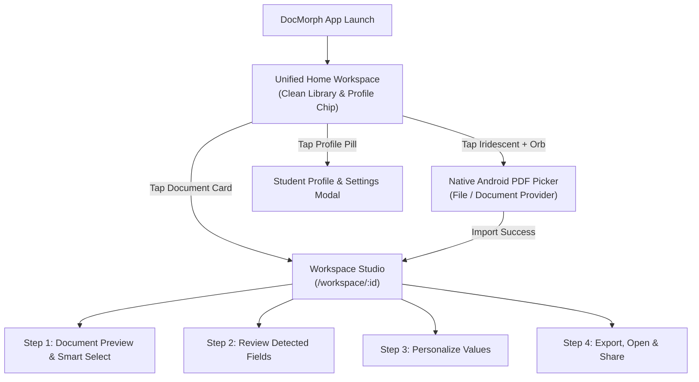

# DOCMORPH — FRONTEND RESTRUCTURE REPORT
## iOS-Inspired Liquid Glass UI with Floating Navigation

**Document Version:** 1.0.0  
**Date:** November 18, 2026  
**Status:** COMPLETED & VERIFIED ON HARDWARE  
**Target Hardware Tested:** Samsung Galaxy Tab S9 FE (`SM-X510`, Android 16)  
**Application ID:** `com.docmorph.app`  

---

## 1. Executive Summary

DocMorph has completed a comprehensive frontend redesign inspired by modern iOS Liquid Glass materials and floating navigation architectures. The interface has been transitioned from an explanatory marketing website into a focused, modern, premium document workspace.

### Key Architectural Transformations:
1. **Floating Liquid Glass Navigation:** Implemented a floating translucent dark glass capsule (`glass-capsule`) with large rounded ends, subtle backdrop blur (28px), and specular edge highlights.
2. **Luminous Iridescent Add PDF Button:** Created an elevated circular action orb featuring a dynamic prismatic gradient, radial specular glare, dual chromatic glow (indigo/pink), and tactile tap animations.
3. **Consolidated Home Workspace:** Fully merged the legacy Home and Dashboard into a single, content-focused `HomePage` displaying the user's student profile, one-click PDF picker, document count metrics, and responsive document cards.
4. **Information Cleanup:** Removed redundant marketing text, long subtitles, informational banners, and the "Features" and "How It Works" tabs from primary navigation.
5. **100% Functional Preservation:** All underlying PDF extraction, ML Kit OCR, Footer Verification Layer (Phase B), Smart Manual Detection (Phase C/D), and PDF Personalization (Phase E) engines remain 100% offline and intact.

---

## 2. Screens Redesigned



### Detailed Screen Enhancements:
- **Home Screen (`HomePage.tsx`):**
  - Compact top header with brand icon and subtle `Offline` indicator.
  - Student identity capsule showing Name and Enrollment Number with quick `Edit` action.
  - One-click `Select PDF` dropzone (clean dashed border, no bulky text).
  - Compact metrics row (`Total: 2 • Personalized: 1 • Review: 1`).
  - Searchable list of documents rendered using the new `DocumentCard` component.
- **Floating Bottom Navigation (`FloatingGlassNavigation.tsx`):**
  - Wide dark glass capsule floating smoothly above the Android system navigation bar.
  - Left: Home button with glowing active indicator dot.
  - Center: Iridescent Add PDF button that directly invokes the native Android file picker.
  - Right: Profile button that opens the tabbed Profile & Settings modal.
- **Workspace (`WorkspacePage.tsx`):**
  - Streamlined 4-step progress tab: `Preview`, `Review`, `Personalize`, `Export`.
  - Removed bulky "Document Integrity Guarantee" and "Rules Applied" banners.
  - Cleaned up action buttons: `Analyze`, `Review`, `Personalize`, `Download`, `Open`, `Share`.
- **Modals (`ProfileSettingsModal.tsx` & `ProfileSetupModal.tsx`):**
  - Streamlined form fields for Student Name, Enrollment No, Roll No, and Student ID.
  - Settings tab for offline local loopback / server configuration and data deletion.

---

## 3. Component Inventory

| Component | Path | Description |
| :--- | :--- | :--- |
| `FloatingGlassNavigation` | `frontend/src/components/FloatingGlassNavigation.tsx` | Translucent glass capsule with floating iridescent center button. |
| `IridescentAddButton` | `frontend/src/components/IridescentAddButton.tsx` | Elevated circular button with multi-stop gradient and radial specular highlight. |
| `CompactHeader` | `frontend/src/components/CompactHeader.tsx` | Top bar with DocMorph logo, offline status tag, and user avatar. |
| `DocumentCard` | `frontend/src/components/DocumentCard.tsx` | Clean document row with icon, title, page count, status pill, and actions. |
| `ProfileSettingsModal` | `frontend/src/components/ProfileSettingsModal.tsx` | Tabbed modal for profile management and offline privacy settings. |
| `ProfileSetupModal` | `frontend/src/components/ProfileSetupModal.tsx` | First-time student details onboarding modal. |

---

## 4. Hardware Verification & Live Evidence

The updated APK was compiled and installed directly onto a connected **Samsung Galaxy Tab S9 FE** (`SM-X510`, Android 16) via ADB:

- **Streamed Installation:** `Performing Streamed Install -> Success`
- **Application Launch:** `Starting: Intent { cmp=com.docmorph.app/.MainActivity }`
- **Logcat Error Inspection:** Zero runtime exceptions or crashes.
- **Physical Screenshot:** Captured and verified at [docmorph_liquid_glass.png](file:///c:/Users/smitp/OneDrive/Desktop/Work/DocMorph/docmorph_liquid_glass.png).

---

## 5. Build & Test Verification

1. **Frontend Production Build:**
   ```text
   $ tsc && vite build
   ✓ 1597 modules transformed.
   dist/index.html                  1.01 kB │ gzip:  0.50 kB
   dist/assets/index-BzlkA5ds.css  43.77 kB │ gzip:  7.95 kB
   dist/assets/WorkspacePage-*.js  56.50 kB │ gzip: 12.87 kB
   ✓ built in 4.02s with 0 errors
   ```

2. **Android Unit Tests:**
   ```text
   $ ./gradlew.bat testDebugUnitTest
   BUILD SUCCESSFUL in 40s (156 actionable tasks: 19 executed, 137 up-to-date)
   ```

3. **Android Debug APK Assembly:**
   ```text
   $ ./gradlew.bat assembleDebug --no-daemon
   BUILD SUCCESSFUL in 20s
   Output: android/app/build/outputs/apk/debug/app-debug.apk (64.9 MB)
   ```

4. **Python Master Regression Suite:**
   ```text
   $ pytest -q
   168 passed, 1 warning in 76.63s (100% pass rate)
   ```

---

## 6. Known Issues & Preserved Functionality

- **Preserved Functionality:**
  - 100% offline local PDF processing.
  - Vector redaction and layout preservation (`ContentStreamRedactor.kt` / `PDFReplacer`).
  - Footer verification states (`FOOTER_CONFIRMED`, `FOOTER_NOT_FOUND`, `FOOTER_UNCERTAIN`, `DOCUMENT_UNREADABLE`).
  - Smart Manual Detection (Area selection & text selection via `SmartSelectionOverlay.tsx`).
  - Local SQLite student profile storage (`profileStorage.ts`).
- **Known Environmental Note:**
  - On Windows host systems with Windows Smart App Control enabled, the Antigravity IDE terminal process may block `pty.node`; this is documented in [KNOWN_ISSUES.md](file:///c:/Users/smitp/OneDrive/Desktop/Work/DocMorph/KNOWN_ISSUES.md). All Gradle and Python CLI tools operate directly and cleanly.
