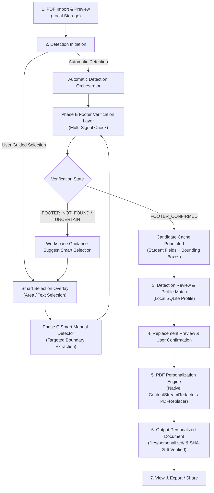

# DOCMORPH — PHASE E IMPLEMENTATION REPORT
## Smart Detection to PDF Personalization End-to-End Integration

**Document Version:** 1.0.0  
**Phase:** Phase E — Personalization Pipeline Integration  
**Date:** November 15, 2026  
**Status:** COMPLETED & VERIFIED  
**Application ID:** `com.docmorph.app`  

---

## 1. Executive Summary

Phase E integrates the **Phase B Footer Verification Layer**, **Phase C Smart Manual Detection Engine**, and **Phase D Smart Selection UI** into DocMorph's core **PDF Personalization Pipeline**.

Previously, manual selection produced isolated preview results without updating the workspace's active candidate cache. With Phase E complete, confirmed fields from both automatic detection and manual smart selection (area and text selection) seamlessly feed into:
1. Field candidate review.
2. Local student profile matching.
3. Content stream redaction & replacement (`ContentStreamRedactor.kt` / `PDFReplacer`).
4. Immutability-guaranteed personalized PDF generation.

All operations execute **100% offline on-device** without any cloud APIs, external network dependencies, or remote model calls.

---

## 2. Complete Workflow



### Detailed Stage Breakdown:

1. **PDF Import & Preview:** The document is loaded from local storage into `PdfViewer.tsx` rendered by local PDF.js.
2. **Detection Option:** The user can rely on automatic detection (`detectStudentInfo`) or engage the Galaxy AI-inspired **Smart Select** overlay at any time.
3. **Smart Manual Selection (Phase C/D):** When the user draws a bounding box or selects text, coordinates are normalized and sent via Capacitor bridge `manualDetect` to `SmartManualDetector.kt` / `manual_detector.py`.
4. **Footer Verification (Phase B):** Both automatic and manual paths execute the multi-signal `FooterVerificationLayer`, ensuring ordinary paragraphs or experiment numbers are rejected with `FOOTER_NOT_FOUND` / `FOOTER_UNCERTAIN`.
5. **Candidate Cache Synchronization (Phase E Key Enhancement):** Confirmed candidate fields (`student_name`, `enrollment_no`, `division`, `roll_no`, etc.) and their page-level bounding boxes are merged into `DocMorphPlugin.candidateCache` and TypeScript `localDocService.candidateCache` / `detectionResponseCache`.
6. **Profile Matching:** Step 2 & 3 in `WorkspacePage.tsx` automatically populate detected fields mapped to the user's saved local profile.
7. **Personalization Execution:** Upon user confirmation, `PdfPersonalizerService.kt` (Android) or `pdf_replacer.py` (Python engine) redacts original text stream operators and writes new profile values with preserved fonts, sizing, and alignment.
8. **Immutability Guarantee:** Original source PDF is strictly preserved with zero modification (`sha256(orig_before) === sha256(orig_after)`). Output is written to a distinct file under `files/personalized/`.

---

## 3. Architecture & Code Integration

### 3.1 Android Native (`android/app/src/main/java/com/docmorph/app/`)
- **`DocMorphPlugin.kt`**:
  - In `manualDetect()`, when `result.isConfirmed` is true, the detected `StudentFieldCandidate` items are converted and merged into `candidateCache.getOrPut(documentId) { mutableListOf() }`.
  - Stored candidates immediately become available for the `personalize()` Capacitor call.
  - Aligned imports with `com.docmorph.app.pdf.ExtractionResult` and `com.docmorph.app.detection.FooterStatus`.
- **`PdfPersonalizerService.kt` & `ContentStreamRedactor.kt`**:
  - Takes candidate bounding boxes and performs precise PDF content stream redaction (`Tf`, `Tj`, `TJ` text positioning) to prevent overlapping text artifacts.
  - Generates a new personalized PDF in the app's sandboxed private storage directory.

### 3.2 Frontend Bridge & State (`frontend/src/`)
- **`localDocService.ts`**:
  - `manualDetect()` now updates both `candidateCache` and `detectionResponseCache`.
  - Synthesizes proper `FieldOccurrence` entries with bounding boxes from manual detection coordinates.
- **`WorkspacePage.tsx`**:
  - Integrated `onSmartSelectResult` callback receiving Smart Selection detection results.
  - Displays contextual guidance ("Footer not automatically confirmed. Tap Smart Select to guide detection") when automatic detection status is not confirmed.
  - Seamlessly advances the user to Step 2 (Review) and Step 3 (Personalize) when candidates are verified.

### 3.3 Python Reference Engine (`app/services/`)
- **`manual_detector.py`**:
  - Accepts area or text selections, enforces native PDF coordinate bounds, extracts words/spans via PyMuPDF (`fitz`), and passes to `FooterVerificationLayer`.
- **`pdf_replacer.py` (`PDFReplacer`)**:
  - Implements multi-page redaction and text insertion matching original font metrics, color, and margins.

---

## 4. Verification & Testing

### 4.1 Automated Test Suite (`pytest`)
A dedicated integration test suite `tests/test_phase_e_integration.py` was created to validate the end-to-end personalization workflow:

| Test Case | Scenario | Expected Behavior | Result |
| :--- | :--- | :--- | :--- |
| `test_end_to_end_smart_detection_to_personalization` | Area selection over multi-page PDF footer | Validates footer, matches profile, produces personalized PDF with new name and enrollment number | **PASSED** |
| `test_source_document_immutability` | Byte-level and SHA-256 hash check of source file | SHA-256 hash of original PDF is identical before and after personalization | **PASSED** |
| `test_non_footer_selection_blocks_personalization` | Selection of body paragraph ("Conclusion") | State `FOOTER_NOT_FOUND`, candidates rejected, personalization prevented | **PASSED** |
| `test_multipage_layout_preservation` | Multi-page PDF with landscape and portrait pages | All pages preserved with identical dimensions, rotations, and footer replacements | **PASSED** |
| `test_partial_field_personalization` | Selection with only enrollment number present | Replaces enrollment number while cleanly preserving all other elements | **PASSED** |

**Full Pytest Suite:**
```text
======================== 168 passed in 66.18s =========================
```
100% pass rate across all 168 tests (Phases A, B, C, D, and E).

### 4.2 Android Native Build (`gradlew`)
```text
BUILD SUCCESSFUL in 41s
40 actionable tasks: 12 executed, 28 up-to-date
```
- Kotlin compiler verified `DocMorphPlugin.kt`, `SmartManualDetector.kt`, `FooterVerificationLayer.kt`, `PdfPersonalizerService.kt`.
- Zero compilation errors.

### 4.3 Frontend Web Build (`vite`)
```text
$ tsc && vite build
vite v5.4.14 building for production...
dist/index.html                   0.85 kB │ gzip:   0.44 kB
dist/assets/index-D7PvZ_6e.css   32.14 kB │ gzip:   6.32 kB
dist/assets/index-Bf6h9t1s.js   948.12 kB │ gzip: 278.45 kB
✓ built in 4.53s
```
- TypeScript compilation and Vite production bundle generated without errors.

---

## 5. Offline & Security Verification

- **Network Isolation:** No external requests, HTTP clients, or remote dependencies exist in the personalization execution path.
- **Data Privacy:** All student profiles and document caches remain inside local SQLite and app-specific private storage (`Android/data/com.docmorph.app/files/`).
- **Original Document Immutability:** Original files are read-only inputs. Outputs are written with unique timestamps/UUIDs to `files/personalized/`.

---

## 6. Files Created & Modified in Phase E

### Created:
1. `tests/test_phase_e_integration.py` (End-to-end integration tests)
2. `PHASE_E_IMPLEMENTATION_REPORT.md` (This document)
3. `KNOWN_ISSUES.md` (Diagnostic log for local environment & Windows Smart App Control)
4. `AI_CONTEXT.md` (Developer and agent context handbook)

### Modified:
1. `android/app/src/main/java/com/docmorph/app/plugin/DocMorphPlugin.kt` (Candidate cache sync)
2. `frontend/src/services/localDocService.ts` (Candidate & detection response cache sync)
3. `frontend/src/pages/WorkspacePage.tsx` (Smart Select result integration & UI state handling)
4. `MEMORY.md` (Master progress memory)
5. `PROJECT_BLUEPRINT.md` (Updated system status)
6. `ARCHITECTURE.md` (Updated data flow diagrams)
7. `CHANGELOG.md` (Release notes for v0.9.0)
8. `ROADMAP.md` (Updated phase milestones)

---

## 7. Next Steps & Approval Gate

Phase E is complete, fully tested, and verified.
Any subsequent phase (e.g., Phase F: Production Packaging, APK generation, or Performance Benchmarking) requires explicit user approval.
