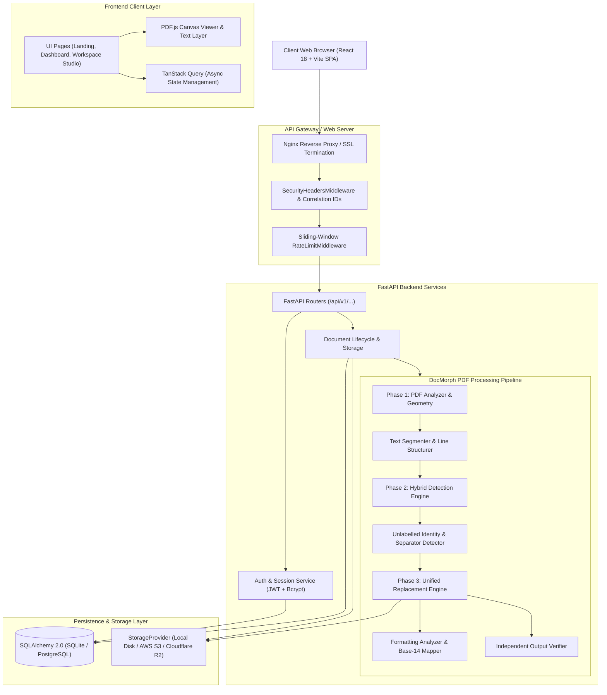
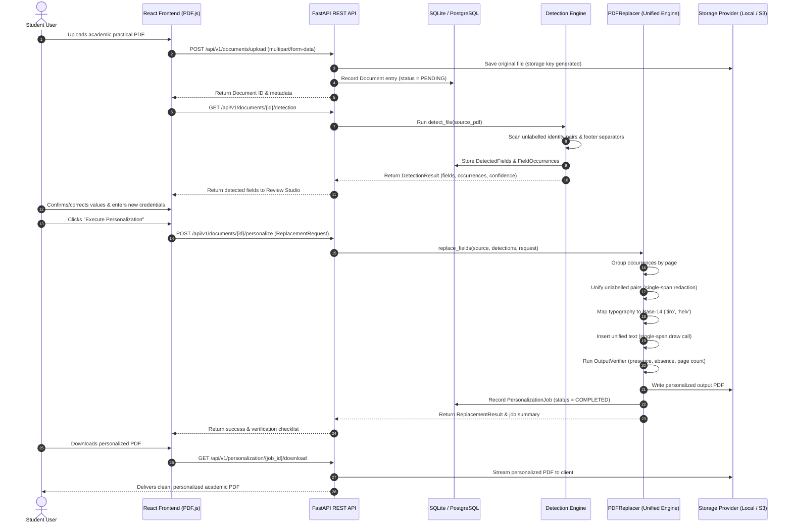
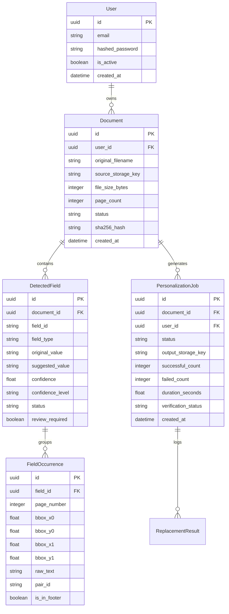
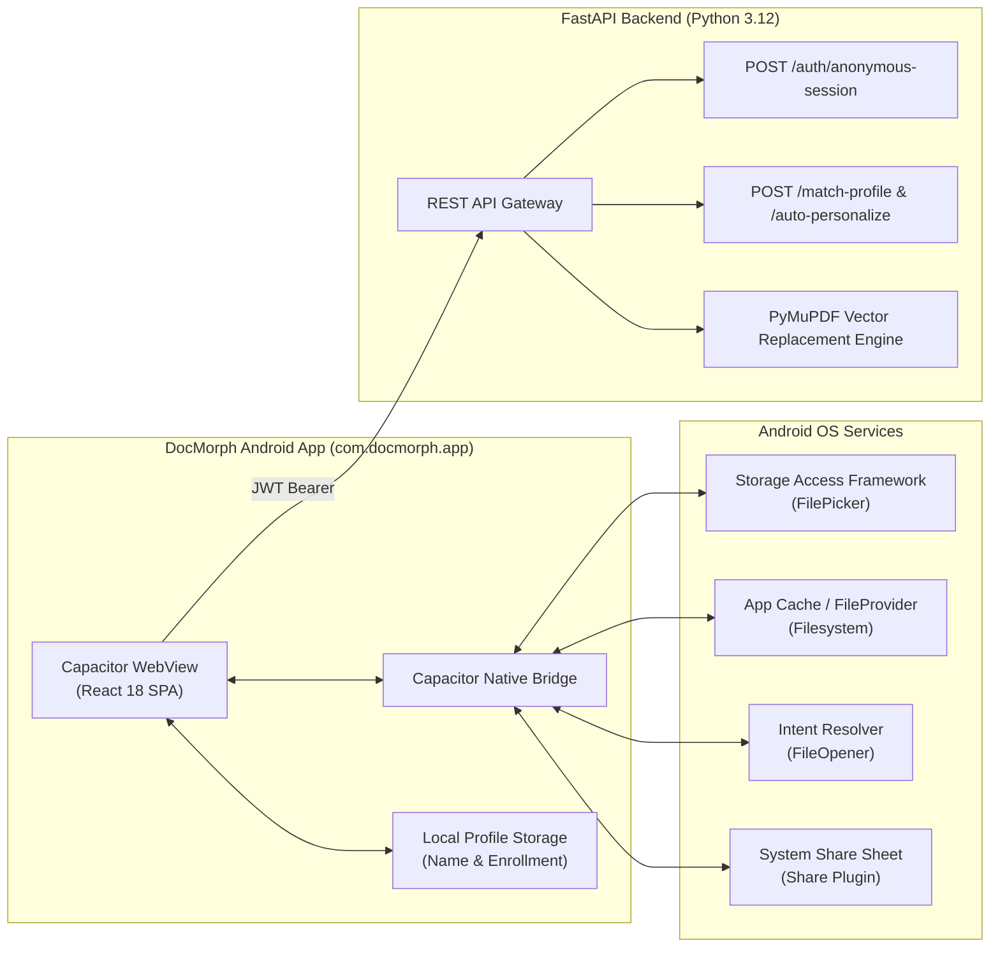

# DOCMORPH — SYSTEM ARCHITECTURE

**Product:** DocMorph  
**Tagline:** Every document, personalized.  
**Category:** Document Personalization SaaS Architecture  
**Version:** 1.0.0  

---

## 1. High-Level Architecture Overview

DocMorph is structured as a modular, decoupled full-stack architecture comprising a high-performance Python FastAPI backend, a precision PyMuPDF processing pipeline, and a modern React 18 TypeScript frontend.



---

## 2. End-to-End Request Lifecycle

The diagram below illustrates the exact execution flow from document upload to final personalized download:



---

## 3. Subsystem Breakdown

### 1. Ingestion & Storage Subsystem
- **`FileValidator`:** Enforces security at the perimeter:
  - Magic-byte signature verification (`%PDF-` at byte offset 0).
  - Maximum upload size limitation (50MB).
  - Safe filename sanitization removing path-traversal sequences (`../`, null bytes, control characters).
- **`StorageProvider` Abstraction:** Isolates storage implementation:
  - **`LocalStorageProvider`:** Stores files under `storage/uploads/` and `storage/personalized/` partitioned by unique prefixes.
  - **`S3StorageProvider`:** Remote object storage adapter for production environments (AWS S3, Cloudflare R2, MinIO).

### 2. PDF Geometry & Layout Analysis Subsystem
- **`TextSegmenter`:** Parses PyMuPDF page dictionaries (`get_text("dict")`) into structured `StructuredLine` and `SpanInformation` objects containing:
  - Exact bounding boxes `(x0, y0, x1, y1)`.
  - Span-level typography: font family, point size, 24-bit color integer, and baseline origin point.
  - Substring bounding box resolution mapping character offsets to spatial coordinates.
- **`FooterDetector`:**
  - Evaluates geometric footer bounds (adaptive 15%–40% lower page area).
  - Identifies bottom-left quadrant alignment ($x \le 48\%$ of width, $y \ge 60\%$ of height).
  - Scans vector graphics paths (`page.get_drawings()`) to locate horizontal vector separator lines.

### 3. Detection & Pattern Recognition Subsystem
- **`DetectionEngine`:** Coordinates hybrid heuristics and regex strategies for labeled fields (`Student Name:`, `Enrollment No:`, etc.).
- **`UnlabelledIdentityDetector`:** Specialized detector for unlabelled academic footer patterns:
  - Parentheses pattern: `Vivekdhedhi(92400120571)` or `Vivek dhedhi (92400120571)`.
  - Delimiter patterns: `Name - ID`, `Name | ID`, `Name, ID`.
  - Inverted patterns: `ID - Name`, `(ID) Name`.
  - Academic stop-words blacklist: Rejects department, university, course, and experiment terminology.
  - Page number exclusion: Strictly rejects right-aligned page indicators (`Page 1 of 5`, isolated digits).
- **`FieldGrouper`:** Groups occurrences across pages, checks for cross-page value conflicts, and computes multi-factor confidence scores.

### 4. Personalization & Redaction Engine
- **`PDFReplacer`:** Executes high-precision document mutation:
  - **Unified Identity Replacement:** Groups unlabelled name and enrollment tasks sharing the same line. Locates full line geometry, redacts the entire line bounding box, and draws the unified string in one call.
  - **Single Field Replacement:** Replaces isolated labeled fields in-place, preserving explicit labels.
  - **Adaptive Font Fitting:** Down-scales font size to fit within available clearance down to 6.0pt; detects physical text collisions.
  - **Immutability Assurance:** Computes pre- and post-generation SHA-256 hashes of the source file to guarantee it is never modified.
- **`FormattingAnalyzer`:**
  - Maps font names to standard Base-14 PDF fonts (`"tiro"` for Times, `"helv"` for Helvetica, `"hebo"` for Helvetica-Bold, `"cour"` for Courier).
  - Converts integer RGB colors to normalized $(R, G, B)$ floats ($0.0 \dots 1.0$).
- **`OutputVerifier`:** Independently inspects the generated output PDF:
  - Validates document readability and page count conservation.
  - Searches for replacement strings on the page.
  - Asserts that original values are completely unextractable at target coordinates.
  - Verifies label preservation.

### 5. API & Security Architecture
- **Authentication:** Standard JWT Bearer token authentication with bcrypt password hashing. Guest mode available for frictionless developer onboarding.
- **Middleware Pipeline:**
  - `SecurityHeadersMiddleware`: Sets `X-Content-Type-Options: nosniff`, `X-Frame-Options: DENY`, `Strict-Transport-Security`, and CSP.
  - `RateLimitMiddleware`: In-memory sliding-window limiter enforcing 60 requests/minute per client IP.
  - Request ID tracing: Generates and propagates `X-Request-ID` across all logs and response headers.
- **Error Handling:** Centralized exception handling mapping `DocMorphError` subclasses to structured JSON error responses with clear human-readable messages.

### 6. Frontend SPA Architecture
- **Tech Stack:** React 18, Vite 6, TypeScript, Tailwind CSS, Lucide React icons.
- **Client State:** TanStack Query handles server state caching, background refetching, and cache invalidation.
- **Document Viewing:** PDF.js renders high-fidelity canvas pages directly in the browser with scalable zoom controls and thumbnail navigation.

---

## 4. Database Entity-Relationship Model



---

## 5. PDF Coordinate System & Geometry Specification

```
(0,0) Top-Left of Page
  +-----------------------------------------------------------+
  |  Header Region                                            |
  |  (x0, y0)                                                 |
  |                                                           |
  |                                                           |
  |  Document Body Content (Line Art, Tables, Text)           |
  |  (Images & Vector art strictly preserved during redaction)|
  |                                                           |
  |-----------------------------------------------------------| <-- Vector Divider Line
  |  Footer Region                                            |
  |  (x0, y0) ---------- (x1, y0)                             |
  |     |   Redaction    |                                    |
  |     |   Rectangle    |  Baseline Origin Point             |
  |  (x0, y1) ---------- (x1, y1)      * (x0, baseline_y)      |
  +-----------------------------------------------------------+ (width, height)
```

- **Coordinates:** Standard points ($1/72$ inch). An A4 page is $595.0 \times 842.0$ pt.
- **Redaction:** Applied with `page.add_redact_annot(rect, fill=(1, 1, 1))` followed by `page.apply_redactions(images=0, graphics=0, text=0)`.
- **Text Insertion:** Text is inserted at `Point(x0, baseline_y)`. Baseline $Y$ coordinate is determined from PyMuPDF span origin data.

---

## 6. Android Native Platform Architecture (Capacitor 8)



### Key Android Architecture Principles
1. **Account-Free Local Identity:** No passwords or external authentication required. Student profile (Name, Enrollment Number) is saved on-device and auto-matched against uploaded documents.
2. **Anonymous Session Isolation:** Each app installation obtains an isolated cryptographic session token from `POST /api/v1/auth/anonymous-session`. All documents and jobs are strictly tenant-isolated to that token's user ID.
3. **Storage Access Framework (SAF):** Native file picking directly accesses cloud and device storage providers without requiring broad storage permissions.
4. **Least-Privilege Security:** App declares only `android.permission.INTERNET`. File sharing and viewing are handled securely via Android's `FileProvider`.
5. **Release Distribution:** Release builds generate both signed APKs for direct sideloading and signed Android App Bundles (AAB) for Google Play.

