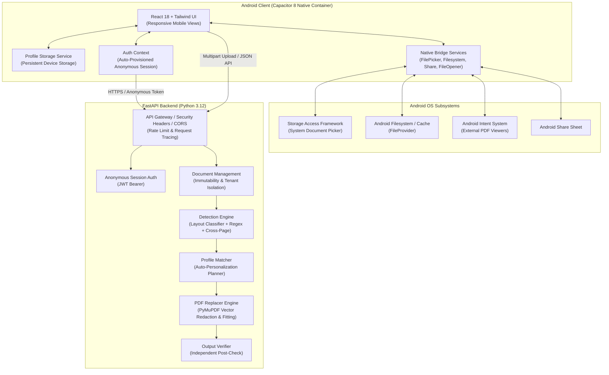

# DOCMORPH — ANDROID SYSTEM ARCHITECTURE

**Product:** DocMorph  
**Tagline:** Every document, personalized.  
**Target Platform:** Android (Capacitor 8 / Android SDK 34–36)  
**Package ID:** `com.docmorph.app`  
**Architecture Status:** Production-Ready  
**Last Updated:** November 2026  

---

## 1. High-Level Architectural Overview

DocMorph for Android transforms the existing React + FastAPI web application into a high-performance, native Android application using **Capacitor 8**. The architecture preserves the existing backend processing engine (PyMuPDF vector redaction, universal layout AI detection, output verification) while delivering a native mobile experience with native document picking, persistent student profile storage, system document viewing, and native share sheets.



---

## 2. Capacitor Foundation & Native Bridge Architecture

### 2.1 Configuration (`capacitor.config.ts`)
```typescript
import type { CapacitorConfig } from '@capacitor/cli';

const config: CapacitorConfig = {
  appId: 'com.docmorph.app',
  appName: 'DocMorph',
  webDir: 'frontend/dist',
  server: {
    androidScheme: 'https',
    cleartext: true, // Permitted for 10.0.2.2 / localhost development
  },
  plugins: {
    StatusBar: {
      style: 'DARK',
      backgroundColor: '#ffffff',
    },
  },
};

export default config;
```

### 2.2 Installed Native Capacitor Plugins
1. **`@capacitor/core` & `@capacitor/android` (`^8.6.0`):** Core runtime and Android platform integration bridge.
2. **`@capawesome/capacitor-file-picker` (`^8.1.1`):** Native Android Storage Access Framework (SAF) file selection returning MIME-validated PDF documents.
3. **`@capacitor/filesystem` (`^8.1.5`):** Device-level file persistence supporting `Directory.Cache` and `Directory.Documents`.
4. **`@capacitor/share` (`^8.0.3`):** System-level Android Share Sheet integration for transmitting personalized output PDFs to chat, mail, or cloud storage apps.
5. **`@capacitor-community/file-opener` (`^8.0.1`):** Android Intent launcher invoking installed PDF viewer applications (Adobe Acrobat, Google PDF Viewer, Drive Viewer, Samsung Notes).
6. **`@capacitor/app` (`^8.1.2`):** Hardware back-button event interception and application lifecycle management.
7. **`@capacitor/status-bar` (`^8.0.4`):** Theme-aware status bar styling matching academic light-theme UI.

---

## 3. Account-Free Architecture & Anonymous Session Security

### 3.1 Eliminating Traditional Auth for Android Users
Academic users require immediate document processing without sign-up friction, password management, or third-party OAuth tracking. DocMorph implements an **account-free personal identity model**:

1. **Client-Side Student Profile:**
   - **Required:** Full Name, Enrollment Number.
   - **Optional:** Roll Number, Student ID.
   - Managed locally by `ProfileStorageService` (`profileStorage.ts`).
   - Persisted securely on device storage with event broadcasting (`docmorph_profile_updated`).
   - Never transmitted to unauthenticated endpoints or third-party telemetry.

2. **Server-Side Anonymous Processing Sessions:**
   - On first application launch, `useAuth.tsx` queries `POST /api/v1/auth/anonymous-session`.
   - The backend generates a cryptographically random session identifier (`uuid.uuid4().hex`) and provisions an isolated user record (`anon_<uuid>@session.docmorph.local`).
   - Issues a signed Bearer JWT token stored securely in client storage.
   - All subsequent document uploads, detections, reviews, and personalization requests are strictly scoped to `current_user.id`.
   - Guessing document IDs yields `404 Not Found` or `401 Unauthorized` for non-owning tokens.

---

## 4. Mobile User Experience & Responsive Design

### 4.1 Responsive Layout Adaptations
- **Safe Area Insets:** The layout respects Android system bars, display cutouts, and gesture navigation bars.
- **Hardware Back Button:** Managed via `NativeService.initializeAppUI()`:
  - If a modal or drawer is open $\rightarrow$ closes modal.
  - If inside Workspace Studio $\rightarrow$ navigates back to Dashboard.
  - If on Dashboard $\rightarrow$ prompts or gracefully exits application (`CapApp.exitApp()`).
- **Touch-Optimized Controls:** Buttons and touch targets adhere to Material Design minimum dimensions ($\ge 48 \times 48\,\text{dp}$).
- **Horizontal Overflow Prevention:** Multi-column tables and studio views stack vertically on narrow viewports ($< 768\,\text{px}$).

---

## 5. Storage Access Framework & File Pipeline

### 5.1 Native File Selection
Instead of requesting broad legacy storage permissions (`READ_EXTERNAL_STORAGE`), DocMorph utilizes the Android Storage Access Framework (SAF) via `@capawesome/capacitor-file-picker`:
- Opens the system document picker supporting local storage, SD card, Google Drive, OneDrive, and Downloads.
- Validates file MIME type (`application/pdf`) and checks size limit ($20\,\text{MB}$).
- Directly decodes document stream into a `File`/`Blob` payload without memory leaks.

### 5.2 Native Document Saving & FileProvider
- Output PDFs generated by the backend are retrieved over HTTPS.
- Saved to device storage using `@capacitor/filesystem`.
- Mapped through Android's `FileProvider` (`${applicationId}.fileprovider`) via `@xml/file_paths`:
  - Granting temporary, scoped URI read permissions to external applications.
  - Protecting internal application private directories from unauthorized access.

### 5.3 Open & Share Pipeline
- **Open Action:** Dispatches an `ACTION_VIEW` intent with `application/pdf` MIME type and `FLAG_GRANT_READ_URI_PERMISSION`.
- **Share Action:** Invokes Android Share Sheet with `url: fileUri` and descriptive metadata.

---

## 6. Permissions & Security Policy

### 6.1 Least-Privilege Manifest
The Android manifest declares only the single strictly necessary permission:
```xml
<uses-permission android:name="android.permission.INTERNET" />
```
**Explicitly Excluded Permissions:**
- $\times$ No `READ_EXTERNAL_STORAGE` or `WRITE_EXTERNAL_STORAGE` (SAF handles document selection).
- $\times$ No `CAMERA`
- $\times$ No `ACCESS_FINE_LOCATION` or `ACCESS_COARSE_LOCATION`
- $\times$ No `READ_CONTACTS`
- $\times$ No `RECORD_AUDIO`

### 6.2 Network Security Configuration (`network_security_config.xml`)
- Enforces strict HTTPS (`cleartextTrafficPermitted="false"`) by default.
- Permits cleartext HTTP exclusively for local development host domains:
  - `localhost`
  - `10.0.2.2` (Android Emulator loopback)
  - `127.0.0.1`

